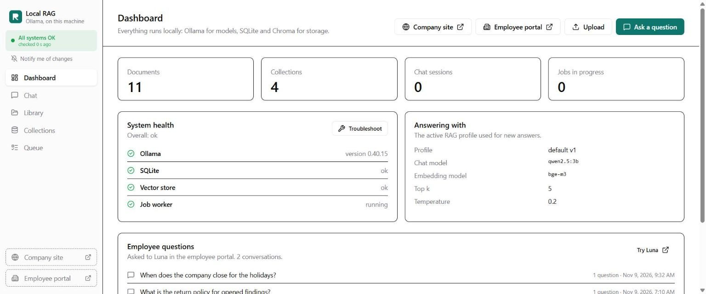
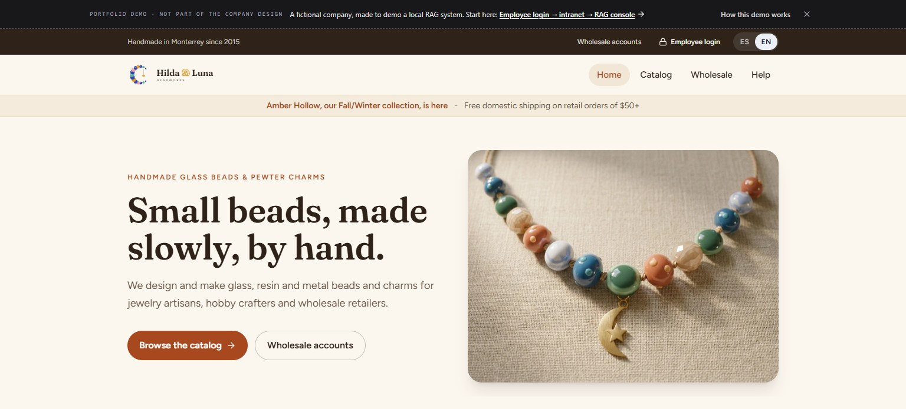
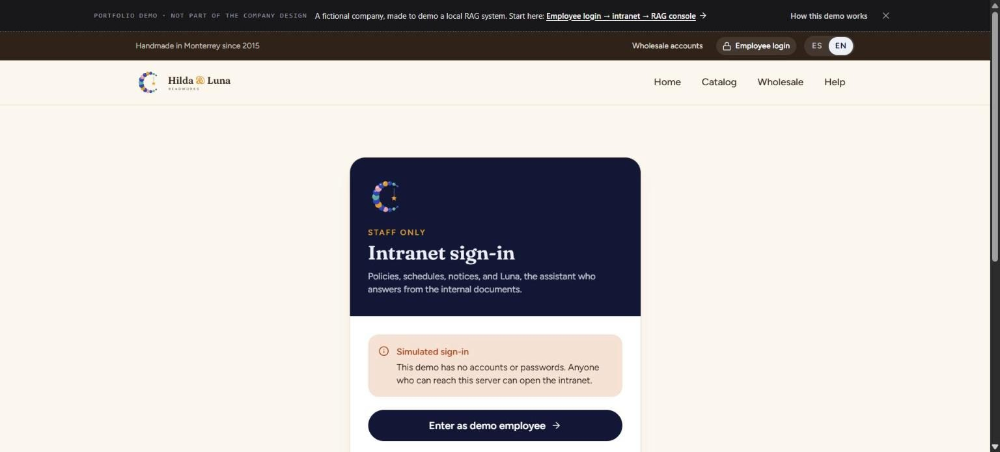
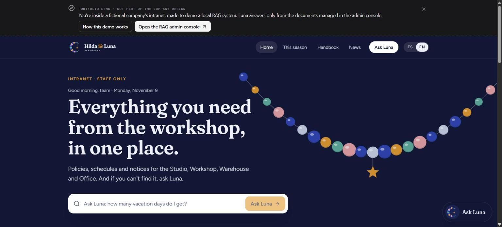
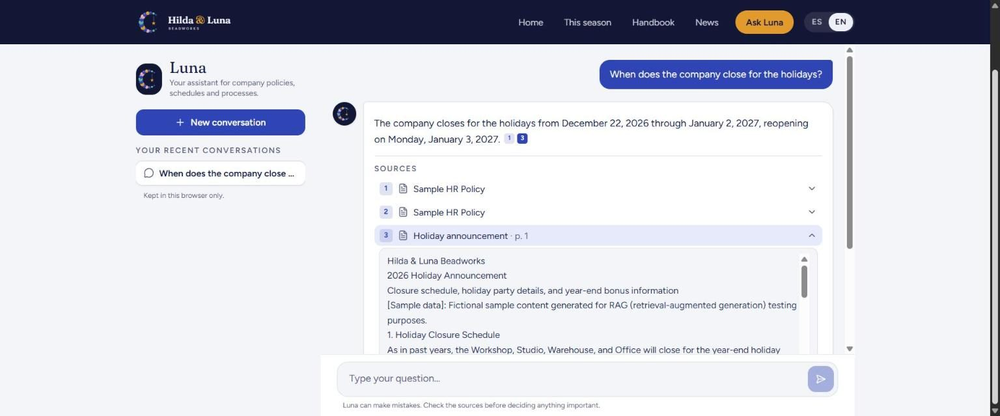
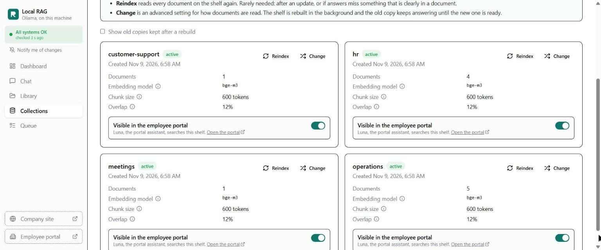
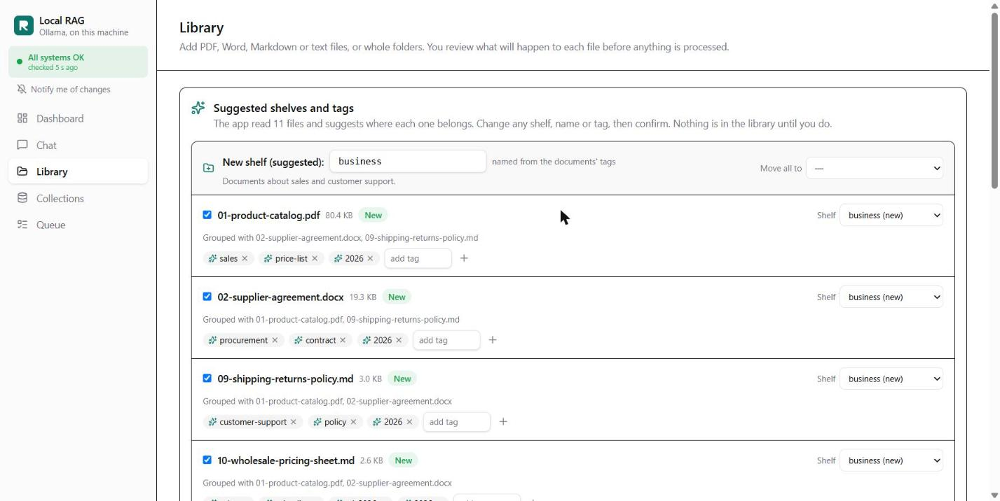

# Getting started

Set up the app, load the demo company, and try everything it does, step by step. It takes about 15 minutes, plus the model download.

> Prefer a web page? The same guide is at **[carlosgild-web.github.io/local-rag-ollama/getting-started.html](https://carlosgild-web.github.io/local-rag-ollama/getting-started.html)**.

## 1. What you need

| | |
|---|---|
| **Memory** | 8 GB of RAM at least; 16 GB is comfortable. On 8 GB, use the small chat model (`qwen2.5:3b`), with Ollama installed on the computer: running Ollama inside Docker needs about 16 GB, because Docker gets only part of the memory. |
| **Disk** | About 4 GB for the small models (`qwen2.5:3b` and `bge-m3`), or 7 GB with `llama3.1`. |
| **Software** | [Docker Desktop](https://www.docker.com/products/docker-desktop/), or [Ollama](https://ollama.com) and Python 3.11+. The start script in step 2 finds what you have and offers to install Ollama or Python if they're missing. Node 22 is only needed to build the web app yourself. |

No GPU or internet connection is needed after the models are downloaded, and nothing you upload ever leaves your computer.

```bash
git clone https://github.com/carlosgild-web/local-rag-ollama.git
cd local-rag-ollama
```

## 2. Start the app

### The easy way: one command

```bash
.\start.cmd        # Windows, in PowerShell or the Command Prompt (double-clicking it works too)
./start.sh         # macOS and Linux
```

It looks at your computer, then asks a few questions the first time:

1. **What you have:** RAM (it suggests `qwen2.5:3b` under 12 GB), free disk, Ollama and Docker.
2. **How to run it.** Each question has a recommended answer (press Enter):

   | You have | It asks | Yes (recommended) | No |
   |---|---|---|---|
   | Docker and Ollama | *Run the app in Docker?* | **B:** the app in a container, using your Ollama and models; nothing is downloaded twice | **C:** with Python, no Docker |
   | Docker, no Ollama | *Run Ollama inside Docker?* | **A:** both in containers; nothing to install, but the models download into Docker (about 3 GB). Under 12 GB of RAM it warns that answers will be much slower, because Docker gets only part of the memory | It offers to install Ollama, then **B** |
   | No Docker | | **C:** Python and Ollama; it offers to install either if missing | |

   With **C**, the built web app is downloaded from the GitHub Release and checked against its SHA-256, so you don't need Node.
3. **When something is installed but not running,** it starts it for you: the Ollama app, or Docker Desktop. If that doesn't work, it tells you why and lets you **wait/retry**, choose another way, or **quit**. It never switches to another way without asking.
4. **Which chat model:** it lists the ones your Ollama already has, and downloads only what's missing, after asking.
5. **It starts the app**, waits until it's healthy, and opens it: the **dashboard** while the library is empty (step 4), the website after that. It ends by saying how it's running, for example "Running in Docker (route B)", with the container names.

It never installs anything without asking, and it shows the exact command first. If port 8000 is taken, it uses the next free one and tells you. Your answers are saved in `.env`, so the next run starts straight away, and each run is logged to `data/start.log`.

| Command | What it does |
|---|---|
| `.\start.cmd stop` / `./start.sh stop` | Stops the app; your documents and models are kept |
| `.\start.cmd status` | Shows how it's running (Docker or Python), the containers and the app's health |
| `--check` | Only explains what it would do; changes nothing |
| `--reconfigure` | Asks the questions again; switching ways stops the old one first. Each way keeps its own library (`data/` for Python, a Docker volume for Docker). |
| `--yes` | Accepts every suggestion without asking |

### Or by hand (pick one way)

### A. Docker, everything in containers (easiest)

```bash
docker compose up -d
docker compose exec ollama ollama pull bge-m3
docker compose exec ollama ollama pull llama3.1
```

On a machine with 8 GB of RAM, use the small chat model instead:

```bash
CHAT_MODEL=qwen2.5:3b docker compose up -d
docker compose exec ollama ollama pull bge-m3
docker compose exec ollama ollama pull qwen2.5:3b
```

In Windows PowerShell, set the variable first: `$env:CHAT_MODEL="qwen2.5:3b"; docker compose up -d`.

The app image is pulled ready-made from GitHub's registry. To build it from the source instead, add `--build` to the first command.

Way A works even if Ollama is already installed on your computer: the container's Ollama isn't exposed on your machine's port 11434, so the two don't clash. It does download the models again, into Docker. To reuse the models you already have, use way B.

### B. Docker, with the Ollama already on your computer

```bash
ollama pull bge-m3
ollama pull llama3.1          # or qwen2.5:3b, then start with CHAT_MODEL=qwen2.5:3b
docker compose -f compose.yaml -f compose.host-ollama.yaml up -d
```

### C. Without Docker

```bash
ollama pull bge-m3
ollama pull llama3.1          # or qwen2.5:3b, with CHAT_MODEL=qwen2.5:3b set below

cd frontend && npm ci && npm run build            # build the web app first
cd ../backend
python -m venv .venv
.venv/Scripts/pip install -r requirements.txt     # macOS/Linux: .venv/bin/pip
.venv/Scripts/python -m uvicorn app.main:app --port 8000
```

Settings are environment variables, such as `CHAT_MODEL`, `OLLAMA_BASE_URL` and `DATA_DIR`. See [`backend/.env.example`](backend/.env.example).

## 3. Check that it's running

Open **http://localhost:8000** (the start script opens the website for you, and tells you if it used another port). The console's dashboard shows **All systems OK** once Ollama, the database, the search index and the background worker all answer.



If something is red, click **Troubleshoot**. It names the cause and the fix, for example "Ollama isn't running" or "the chat model isn't installed".

## 4. Load the demo company

Hilda & Luna Beadworks is a fictional bead maker with 11 documents: a handbook, safety training, a catalog, a price sheet, an FAQ and more.

While the library is empty, the **dashboard** shows a *New here?* card:

1. **See the documents** lists the 11 originals by the shelf each goes into. PDFs and text files open in a new tab, and Word files download, so you can read exactly what the assistant will answer from. They're also in your copy of the project, in `backend/demo/hilda-luna/`.
2. **Load the demo company** indexes them, with a progress bar. It takes a few minutes on a laptop.
3. When it's done, the card links to the company website and the employee portal.

It creates four shelves (customer-support, hr, meetings, operations). Loading again skips every file as a duplicate. Later, every document in the **Library** has an *Open original* button.

<details><summary>For developers: the same from the command line</summary>

```bash
docker compose exec app python -m app.cli seed-demo                 # in Docker
cd backend && .venv/Scripts/python -m app.cli seed-demo             # without Docker
```

It ends with `11 ingested, 0 skipped`.
</details>

## 5. Take the tour

**① The company's website:** http://localhost:8000/site. The dark strip on top is the demo guide. It isn't part of the company's design; it shows reviewers the way.



**② Employee login → Enter as demo employee.** The sign-in is a simulation: no accounts, one button.



**③ The intranet.** Click **How this demo works** in the banner for the path and things to try.



**④ Ask Luna** something, like "When does the company close for the holidays?", and open a source to see the exact passage. Switch to **ES** and ask in Spanish. Ask something the documents don't say, and Luna says so instead of guessing.



**⑤ Open the RAG admin console** from the banner. Under **Collections**, turn a shelf's **Visible in the employee portal** switch off, and Luna stops using it.



**⑥ Try your own documents.** In **Library**, drop a few files or a whole folder. The app suggests a shelf and tags for each one; you confirm, and they're indexed. Then ask about them in **Chat**.



The [reviewer walkthrough](docs/walkthrough.md) goes through the same tour in more detail.

## 6. Run the tests

```bash
cd backend
.venv/Scripts/pip install -r requirements-dev.txt
.venv/Scripts/python -m pytest -q                        # 189 tests, with fakes: no Ollama needed
.venv/Scripts/ruff check . && .venv/Scripts/ruff format --check .
cd ../frontend && npm run build                          # type check and build
```

The **end-to-end test** drives the running app with the real model, about 60 questions and every app mechanic. It takes 1–3 hours on a laptop CPU; see [`e2e/README.md`](e2e/README.md). CI runs the unit tests, the linters, the frontend build and a Docker build on every push.

## 7. If something goes wrong

| Problem | What to do |
|---|---|
| "Ollama isn't running" | Start Ollama (way B or C), or check `docker compose ps` (way A). The troubleshooter shows the address it's trying. |
| "Model not installed" | Run the `ollama pull` lines from step 2 for the models the app expects (`CHAT_MODEL`, `EMBEDDING_MODEL`). |
| Answers are slow | That's normal on a CPU: 20–60 seconds an answer. Use `qwen2.5:3b` on smaller machines. |
| Port 8000 is in use | The start script picks the next free port. By hand: set `APP_PORT=8001` before `docker compose up -d`. |
| The start script chose the wrong way or model | Run it with `--reconfigure`, or delete `.env`. What happened is in `data/start.log`. |
| Start over with no documents | Way A or B: `docker compose down -v` (**deletes** the app's data and the downloaded models). Way C: delete `backend/data/`. |

To stop the app, run `.\start.cmd stop` (or `./start.sh stop`), or `docker compose down` if you started it by hand. Your documents and models are kept.

> **Security:** there are no logins. Run the app on your own computer or a private network only. See [SECURITY.md](SECURITY.md).
