# Local RAG with Ollama

[](https://github.com/carlosgild-web/local-rag-ollama/actions/workflows/ci.yml)
[](LICENSE)

*Python · FastAPI · SQLite FTS5 · ChromaDB · Ollama · React + TypeScript · Docker*

**Ask questions about your own documents, fully offline.** Every answer is grounded in your files and cites them. When the answer isn't in your files, the app says so.

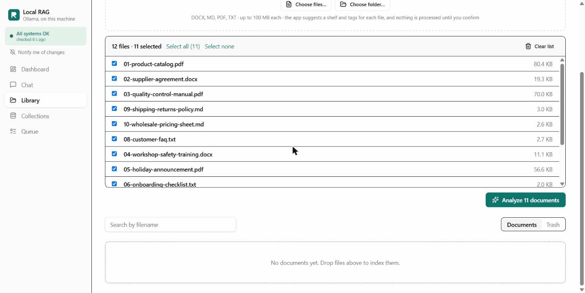

Drop in PDFs, Word files, Markdown or plain text. The app reads them, suggests where each one belongs, and answers questions in a chat with numbered citations you can click to see the exact passage. The chat model and the embeddings run in [Ollama](https://ollama.com) on your machine, so nothing is sent anywhere.

**[Getting started, step by step →](GETTING_STARTED.md)** ([as a web page](https://carlosgild-web.github.io/local-rag-ollama/getting-started.html)): install, load the demo company, try everything and run the tests.

**[Take the 10-minute reviewer walkthrough →](docs/walkthrough.md)**: the demo company's website, its intranet with Luna, and the admin console, with screenshots. There's also a [slide deck](https://carlosgild-web.github.io/local-rag-ollama/showcase/).

## What it does

- **Answers only from your documents.** The model is told to use only the passages it was given. If they don't hold the answer, it replies *"not found in the documents"* instead of guessing.
- **Shows its sources.** Answers cite `[1]`, `[2]`… Click one to read the passage, with file, page and score. A warning appears if an answer cites nothing or cites a source that doesn't exist.
- **Organises new files for you.** Drop a folder and the app suggests a shelf for each file, either an existing one or a new one it names, plus tags such as `hr`, `price-list` or `q4-2026`. You change anything, then confirm. Nothing is indexed before you confirm.
- **Keeps versions.** The same file twice is skipped. A changed file becomes v2 and the old version stays available. Deletes go to a 30-day trash you can restore from.
- **Explains problems in plain words.** A troubleshooter checks Ollama, the database, the search index and the background worker, and gives the cause and the fix. It can draft a (simulated) support ticket for the next support level.
- **Works in English and Spanish**, with search that combines meaning (vectors) and exact words (keywords).
- **Comes with a demo company.** *Hilda & Luna Beadworks*, a fictional bead maker, has a public website at `/site` and an intranet at `/intranet`. Employees ask **Luna**, an assistant that searches every shelf the admin shares with the portal, in a floating chat or full screen, in Spanish or English. See [Employee portal](#employee-portal).

| | |
|---|---|
| 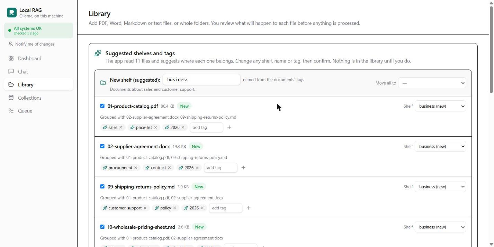 **Suggested shelves and tags.** Review, rename, move and retag, then confirm. | 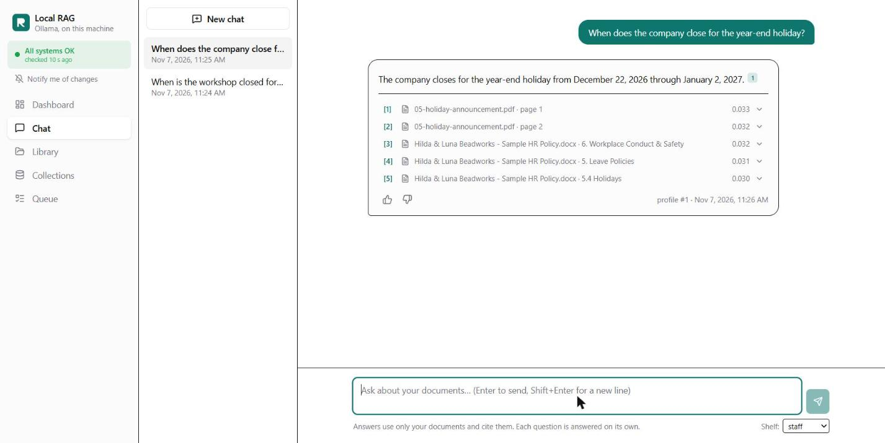 **Grounded answers.** Numbered citations, with the sources listed under the answer. |
| 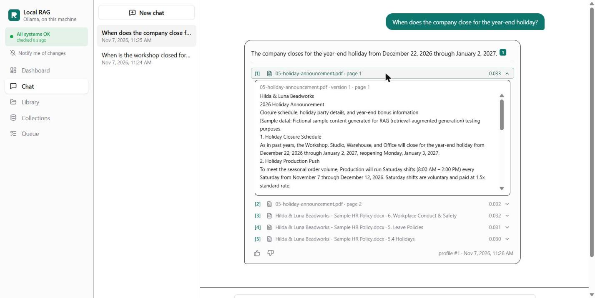 **Check any citation.** The exact passage the answer came from. | 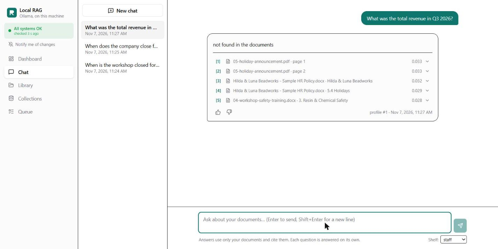 **No guessing.** A question the shelf can't answer gets "not found in the documents". |
| 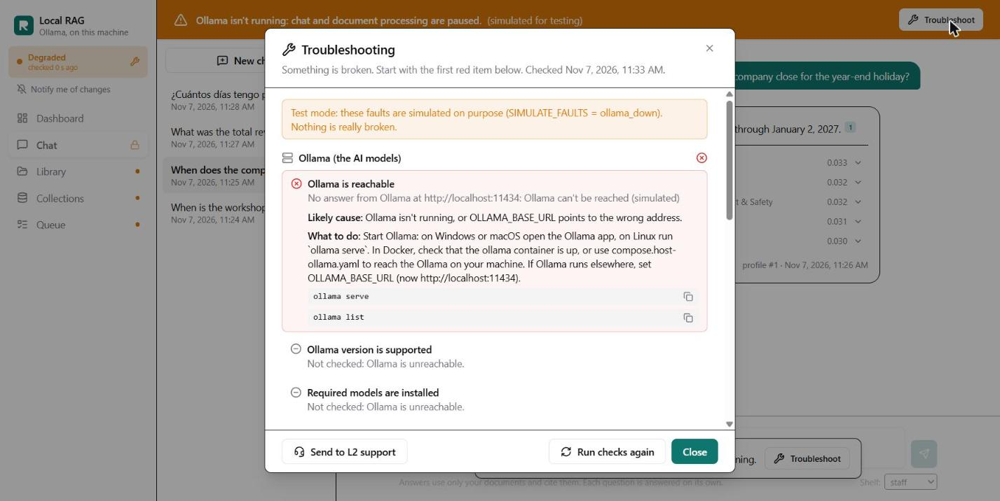 **When something breaks,** the app names the cause and the fix, and pauses what can't work. | 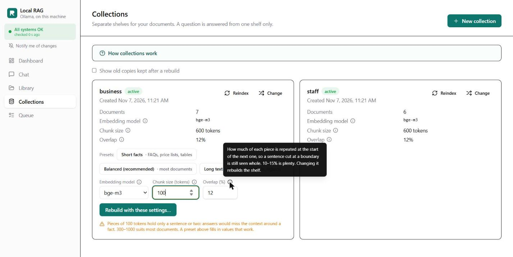 **Settings without jargon.** Tooltips, presets, and warnings for unusual values. |

## Employee portal

The console above is for the person who manages the documents. The portal shows the other side: the people who need answers from them.

| | |
|---|---|
| 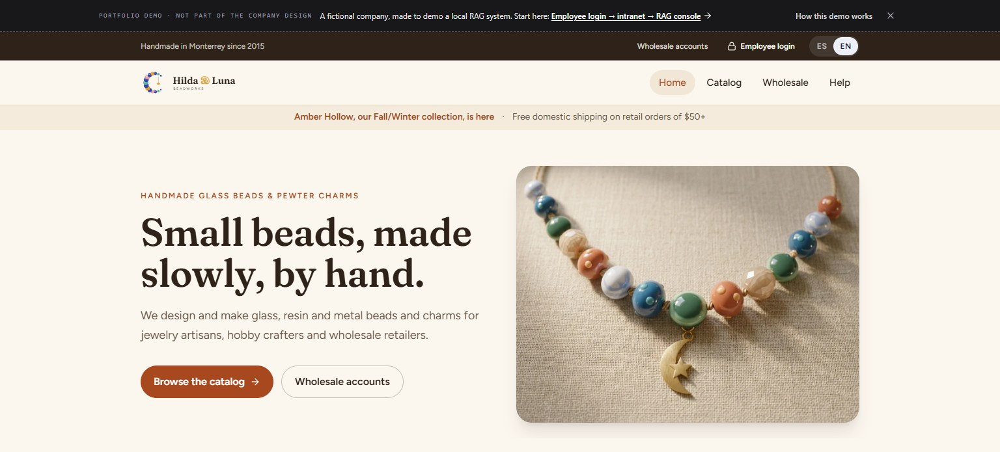 **The company's website.** Written from its customer documents, with product photos made with Google Gemini. | 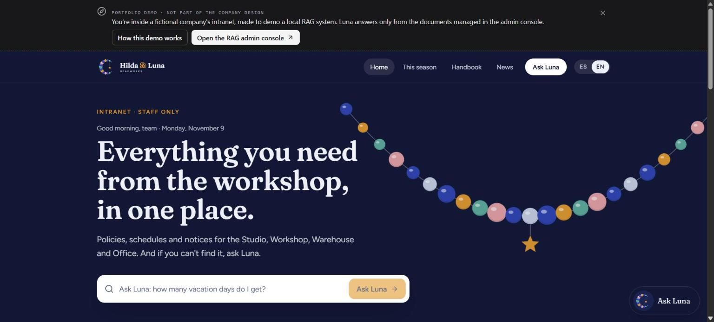 **The intranet.** Season dates, handbook highlights and news. The banner on top is the reviewer's demo guide. |
| 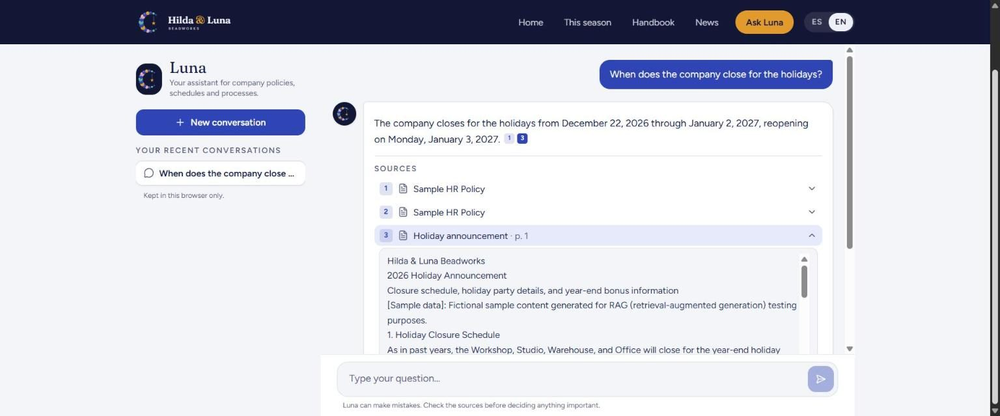 **Luna.** Answers only from the documents, with the cited passage one click away. | 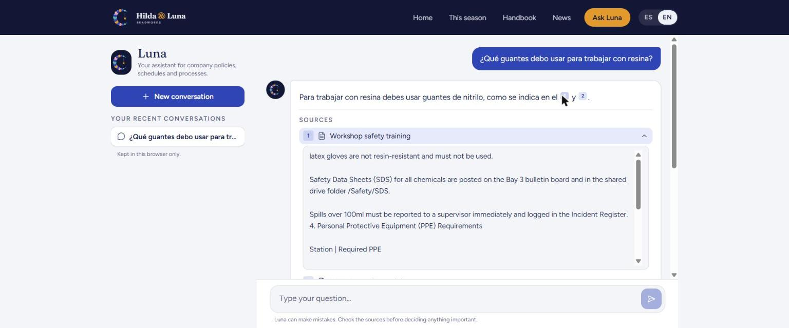 **In Spanish too.** A Spanish answer from an English manual. |

- **A company intranet** for *Hilda & Luna Beadworks*, a fictional bead and charm maker in Monterrey. It has a season timeline, handbook highlights, department hours and news, all written from the demo documents.
- **Luna**, in a floating chat bubble on every page or full screen at `/intranet/luna`. Luna searches **every shelf marked "Visible in the employee portal"** (a switch on each shelf in Collections). Each shelf is searched with its own embedding model, and the results are merged by rank ([decision 0010](docs/decisions/0010-employee-portal.md)).
- **Same rules as the console:** answers only from the documents, numbered citations with the exact passage, and a clear "I couldn't find this" when the documents don't say.
- **ES / EN switch.** The interface changes language and Luna is asked to answer in it, whatever language the documents are in.
- **Kept apart, still visible.** Employee chats don't appear in the console's chat history; the dashboard lists them under *Employee questions*, with their 👍/👎 feedback stored like any other answer.
- **Simulated internal access:** there is no real sign-in. The footer says so.
- **A public website** at `/site`, the company's outside face. It's modeled on real bead and charm makers: a home page with collections and the workshop's story, a catalog, a wholesale page, and help on shipping, returns and FAQ. All of it is written from the customer-facing demo documents. Its photos were made with Google Gemini: each product photo starts from a Blender render of the catalog item, so colors and shapes match ([how the images are made](docs/site-images.md), [decision 0012](docs/decisions/0012-site-images-with-gemini.md)). Its forms are demos that send nothing. **Employee login** opens a simulated staff sign-in, with one button into the intranet ([decision 0011](docs/decisions/0011-public-site.md)).

### Try the demo

Start the app ([Quick start](#quick-start)), then load the demo company's 11 fictional documents with one command (Ollama must be running):

```bash
cd backend && .venv/Scripts/python -m app.cli seed-demo     # local: one shelf per folder in backend/demo/hilda-luna/
docker compose exec app python -m app.cli seed-demo         # Docker
```

Then follow the path a visitor would:

1. **http://localhost:8000/site**: the company's public website.
2. **Employee login → Enter as demo employee**: the intranet. Ask Luna something, for example "When does the company close for the holidays?", and open a source.
3. **Demo guide → Open the RAG admin console**: the console behind it all, with shelves, automatic versions, the trash, the job queue and the troubleshooter.

The **demo guide** at the top of the site and the intranet is marked as outside the company design. It's there for reviewers, and its *How this demo works* panel lists things to try. The dashboard's **Company site** and **Employee portal** buttons lead back the other way. The [walkthrough](docs/walkthrough.md) covers the same path, step by step.

## How it works

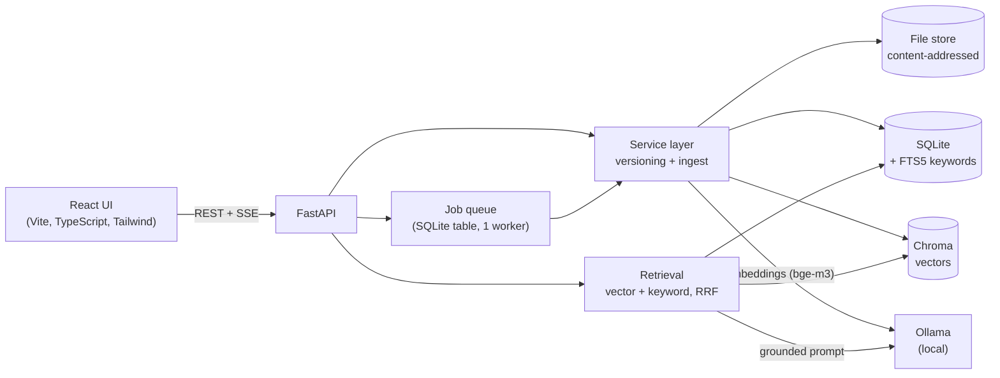

**Adding a document:**
1. The file is stored once under its SHA-256 hash.
2. It is parsed: PyMuPDF for PDF, python-docx for Word including tables, Tesseract OCR for scanned pages.
3. It is cut into overlapping pieces of about 600 tokens.
4. The pieces are embedded with `bge-m3` and indexed twice: in Chroma (vectors) and in SQLite FTS5 (keywords).

**Answering a question:**
1. Both indexes are searched on the chosen shelf.
2. The two rankings are fused with reciprocal rank fusion.
3. The top 5 passages go into a prompt that allows answers only from them, with citations.
4. The answer streams back over server-sent events.
5. Every answer stores the passages and scores it used, so it can be reproduced later, and a citation check rates it.

## Engineering highlights

- **One service layer.** Every write to SQLite, Chroma and the file store goes through `versioning/` and `ingest/`. Routes and the CLI never write directly.
- **Content-addressed files and versioning.**
  - Same hash: skipped.
  - Same name with new content: a new version; the old pieces stay indexed but inactive.
  - Rollback only flips a pointer and never re-embeds.
- **Blue/green rebuilds.** Changing a shelf's embedding model or chunking builds a new copy in the background and swaps it in when it's ready. The old copy answers until then ([0003](docs/decisions/0003-per-collection-chunks.md)).
- **Reproducible answers and an audit log.** Each answer records its retrieval profile, passages and scores. Uploads, deletes, rollbacks, rebuilds and settings changes are audited.
- **Testable by design.** The LLM, embedding and vector-store clients are interfaces with fake implementations, so the unit tests and CI never need Ollama.
- **Measured decisions.** Choices are tested on real data and written down:
  - the one-line citation hint beat a long reminder, 6/6 vs 2/6 valid citations ([0007](docs/decisions/0007-citation-reminder-and-check.md))
  - grouping by department beat clustering by similarity for suggesting shelves, 11/11 vs 5–19 of 30 ([0009](docs/decisions/0009-suggested-shelves-and-tags.md))
- **Built for one small machine.** One worker, an in-process job queue on SQLite (no Redis), and a 3B chat model on a 7.2 GB RAM laptop ([0004](docs/decisions/0004-small-chat-model-on-low-ram.md)).

## Quality

| Check | Result |
|---|---|
| Unit and API tests (fakes, run in CI) | 179 tests pass; `ruff` clean |
| CI (GitHub Actions) | lint, tests, frontend build and `docker build` on every push |
| End-to-end test: real Ollama, 11 sample documents, about 60 questions, plus Luna through the portal | **53/53** must-pass checks · 53/57 answer checks · 31/38 citations correct · 7/7 refusals · 6/6 portal questions ([report](docs/test-reports/2026-11-09-e2e.md)) |

The end-to-end kit in [`e2e/`](e2e/) drives the same API the UI uses. It checks:
- ingestion of every file type, answers against expected facts, citations and grounding
- versions and rollback, trash and restore, jobs (cancel and retry), reindex and rebuild
- suggested shelves, prompt injection, and recovery after a restart

## How it was built

I built this project with [Claude Code](https://claude.com/claude-code) as an AI coding assistant.

**My part:**
- I set the requirements and made the product decisions, e.g. "suggest a shelf, but let me decide", "few broad shelves", "never lose data".
- I tested every step in the browser, and reviewed the changes and the test reports.

**Claude Code's part:** it wrote most of the code under that direction, and proposed and measured the technical options.

Every deviation from the plan is recorded in [`docs/decisions/`](docs/decisions/), and every change was checked by the unit tests, in the browser, and by the end-to-end kit.

## Quick start

You need [Ollama](https://ollama.com) with a chat model and the embedding model:

```bash
ollama pull bge-m3
ollama pull llama3.1        # or qwen2.5:3b on a machine with ~8 GB RAM
```

**Docker:** the app image is pulled from `ghcr.io/carlosgild-web/local-rag-ollama` (add `--build` to build it from source instead).

```bash
docker compose up -d                                                 # Ollama in its own container
docker compose exec ollama ollama pull bge-m3
docker compose exec ollama ollama pull llama3.1                      # or qwen2.5:3b with CHAT_MODEL=qwen2.5:3b
docker compose -f compose.yaml -f compose.host-ollama.yaml up -d     # or use the Ollama on your machine
```

**Local (Windows / macOS / Linux):**

```bash
cd frontend && npm ci && npm run build                                    # build the UI first: FastAPI serves it
cd ../backend
python -m venv .venv && .venv/Scripts/pip install -r requirements.txt   # macOS/Linux: .venv/bin/pip
.venv/Scripts/python -m uvicorn app.main:app --port 8000                  # migrations run on start
```

Open http://localhost:8000. For UI work, run `npm run dev` in `frontend/`: it serves http://localhost:5173 and forwards `/api` to port 8000. Settings are environment variables; see [`backend/.env.example`](backend/.env.example).

**Low on RAM?** Set `CHAT_MODEL=qwen2.5:3b` ([decision 0004](docs/decisions/0004-small-chat-model-on-low-ram.md)).

> **Run it locally or on a private network.** There are no logins: the admin console, the intranet and uploads are open to anyone who can reach the server. Docker publishes its ports on `127.0.0.1` only, for that reason.

## Testing

```bash
cd backend
.venv/Scripts/python -m pytest -q                       # no Ollama needed
.venv/Scripts/ruff check . && .venv/Scripts/ruff format --check .
cd ../frontend && npm run build                         # type check + build
```

To run the end-to-end test against a running server, see [e2e/README.md](e2e/README.md).

## Repository layout

```
backend/app/        FastAPI app: api/, core/, ingest/, retrieval/, llm/, versioning/, jobs/, db/
backend/tests/      pytest suite (fakes only)        backend/migrations/  Alembic
frontend/src/       React + Vite + TypeScript + Tailwind: pages/, components/, api/, hooks/
frontend/src/portal/  The employee portal and Luna (lazy-loaded, own fonts)
frontend/src/site/    The demo company's public website (lazy-loaded)
scripts/            site image tools: Gemini prompts, Blender references, WebP prep (build-time only)
backend/demo/       Fictional Hilda & Luna Beadworks documents for `seed-demo`
e2e/                End-to-end test kit and a fictional sample corpus
docs/decisions/     Why things are the way they are   docs/test-reports/  End-to-end reports
docs/showcase/      Slide deck and screenshots
```

Your documents, the database, vectors and backups live in `backend/data/`, which is never committed.

## Status

- **Done:** Phases 0–4 of [PLAN.md](PLAN.md), plus the UI improvements in v0.5.0 ([CHANGELOG](CHANGELOG.md), [decision 0008](docs/decisions/0008-ui-improvements-scope.md)) and in v0.6.0 the employee portal with Luna, the company's public website and a reviewer's demo guide ([decision 0010](docs/decisions/0010-employee-portal.md), [decision 0011](docs/decisions/0011-public-site.md)).
- **Next:** a versions UI, a control panel, an evaluation set, hardening, and polish.

## License

[MIT](LICENSE). The bundled Fraunces and Figtree fonts keep their own [SIL Open Font License 1.1](https://openfontlicense.org). Hilda & Luna Beadworks, its people and its documents are fictional. The website's photos were made with Google Gemini ([details](docs/site-images.md)).
