# Local RAG with Ollama

[](https://github.com/carlosgild-web/local-rag-ollama/actions/workflows/ci.yml)
[](LICENSE)


Ask questions about your own documents, fully offline. Drop in PDFs, Word files, Markdown or plain text: the app suggests where each one belongs, keeps every version, and answers in a chat with numbered citations you can click to read the exact passage. The chat model and the embeddings run in [Ollama](https://ollama.com) on your machine, so nothing is sent anywhere. **Every answer cites its source, or says it isn't there.**

> **Evolved into** [Luna Hybrid Agent](https://github.com/carlosgild-web/luna-hybrid-agent): the same app with a local agent on top that picks, per question, between these documents, a business database and an exchange-rate API, and shows every step.

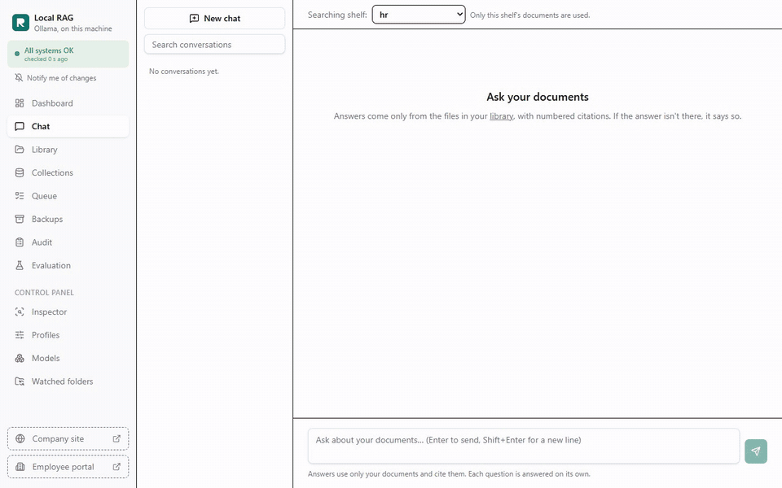

<sub>The app, `bge-m3` on Ollama, both indexes, citation repair and the passages are real; the answers are `qwen2.5:3b`'s, recorded and replayed so the GIF is the same on every run ([decision 0042](docs/decisions/0042-video-mode-and-gif-harness.md)).</sub>

### The 2½-minute video: a real model, under the hood

VIDEO_URL

`qwen2.5:3b` and `bge-m3` on a laptop CPU, with a panel showing the code and data behind each step: adding files, a cited answer and its passage, "not found", a new version and a rollback, the retrieval inspector and the evaluation. Long waits are cut and labelled. [What it shows, and how it was recorded →](docs/video.md)

```bash
git clone https://github.com/carlosgild-web/local-rag-ollama.git
cd local-rag-ollama
.\start.cmd      # Windows (or double-click it); ./start.sh on macOS and Linux
```

No API key and no Docker needed: the script finds the Ollama and Python you have (and offers to install them if missing), asks before downloading the two small models, and opens the dashboard, where the demo company loads with one click. [More ways to run it →](#try-it)

Built by **Carlos Velazquez** · [LinkedIn](https://www.linkedin.com/in/carlos-v-90b99149) · open to AI engineering roles (remote)

## What this demonstrates

- **Retrieval engineering**: hybrid search (`bge-m3` vectors in Chroma + SQLite FTS5 keywords) fused with reciprocal rank fusion, an optional cross-encoder reranker, all measured: Hit@5 100 %, MRR 0.934 ([`retrieval/`](backend/app/retrieval/), [Evaluation](#evaluation)).
- **Grounded generation**: answers only from the passages, citation repair, and an honest "not found in the documents" (every refusal in the golden set) ([`prompt.py`](backend/app/retrieval/prompt.py), [`citation_repair.py`](backend/app/retrieval/citation_repair.py)).
- **Data you can trust**: content-addressed files, versions and rollback without re-embedding, blue/green rebuilds, an audit log ([`versioning/`](backend/app/versioning/)).
- **Measured decisions**: a 53-question golden set took answers from 70 % to 91 %, and a rule that broke three answers was rejected ([decisions 0019–0023](docs/decisions/)).
- **Runs on one small machine**: a 3B model on a 7.2 GB laptop CPU, one worker, no Redis; Docker and a one-command start ([decision 0004](docs/decisions/0004-small-chat-model-on-low-ram.md), [decision 0013](docs/decisions/0013-one-command-start.md)).
- **Production habits**: 403 tests (92 % coverage), CodeQL and secret scanning, Prometheus metrics, JSON logs, a [repository audit](docs/test-reports/2026-11-14-repo-audit.md).

## The problem

A small company's knowledge lives in PDFs, Word files and notes: an HR policy, a price list, a supplier agreement, last quarter's meeting notes. Someone asks "when do we close for the holidays?" or "how long do customers have to return beads?", and the answer is in one of them, possibly in an old version. A chat model alone makes up a plausible answer; a cloud service means sending the files away. This app keeps everything on one machine and only answers from the files, with the passage to prove it.

## What it does

- **Answers only from your documents**, with numbered citations you can click to read the passage, and *"not found in the documents"* when they don't hold the answer.
- **Organises new files for you.** Drop a folder: each file gets a suggested shelf and tags. You change anything, then confirm; nothing is indexed before you do.
- **Keeps versions.** The same file twice is skipped, a changed file becomes v2, rollback is one click, and deletes go to a 30-day trash.
- **Lets you look inside.** The retrieval inspector shows every passage a question finds, its vector and keyword ranks, where the cut to the model falls, and the exact prompt; sliders re-rank live.
- **Comes with a demo company**, *Hilda & Luna Beadworks*: 11 fictional documents, a public website and an intranet where employees ask **Luna**, in English or Spanish ([the employee portal](docs/portal.md)).

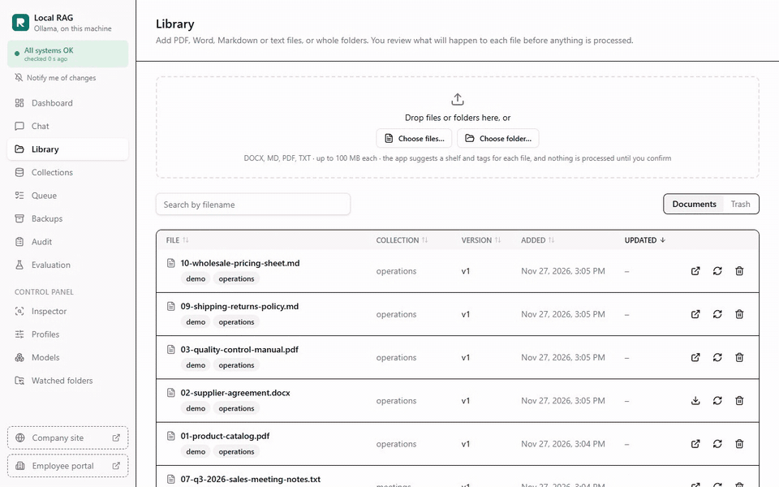

<sub>Adding three files: the suggestions come from `bge-m3` on Ollama; the analysis wait (about 10 s on the laptop) is cut.</sub>

The full list (backups, the troubleshooter, document history, watched folders, models and profiles) is in [docs/features.md](docs/features.md).

## Every answer cites its source, or says it isn't there

The rules the code keeps, whatever the model does, each with the test that checks it ([CLAUDE.md](CLAUDE.md)):

| # | Invariant | Where it is enforced |
|---|---|---|
| 1 | **Grounded answers only.** The prompt allows answers only from the passages, requires citations, and requires "not found in the documents" otherwise; no profile can drop that rule | [`retrieval/prompt.py`](backend/app/retrieval/prompt.py) · `test_build_prompt_includes_not_found_rule_and_question`, `test_profiles_are_versioned_and_keep_the_grounding_rule` |
| 2 | **Every citation is checked** against the passages, and moved when another passage holds the claim's figures | [`retrieval/citation_repair.py`](backend/app/retrieval/citation_repair.py) · `test_a_number_only_another_passage_has_moves_the_citation` |
| 3 | **Nothing is indexed before you confirm** the suggested shelves and tags | [`ingest/intake.py`](backend/app/ingest/intake.py) · `test_new_files_are_grouped_by_audience_and_nothing_is_indexed_before_confirm` |
| 4 | **Content-addressed files.** Each original is stored once, as `files/<sha256>.<ext>`; the same file twice is skipped | [`ingest/file_store.py`](backend/app/ingest/file_store.py) · `test_store_file_is_content_addressed`, `test_duplicate_file_is_skipped` |
| 5 | **Versions never lose data.** A changed file is a new version and the old pieces stay; rollback flips a pointer without re-embedding; deletes are soft | [`versioning/service.py`](backend/app/versioning/service.py) · `test_changed_content_creates_new_version_and_old_chunks_remain`, `test_rollback_flips_pointer_without_reembedding`, `test_soft_delete_sets_trashed_at_and_restore_clears_it` |
| 6 | **One embedding model per shelf.** Changing it builds a new copy in the background and swaps it in (blue/green) | [`versioning/service.py`](backend/app/versioning/service.py) · `test_collections_create_conflict_and_blue_green_reindex`, `test_rebuild_job_builds_then_swaps` |
| 7 | **Reproducible answers.** Each answer stores its profile, passages and scores | [`api/routes/chat.py`](backend/app/api/routes/chat.py) · `test_chat_streams_and_records_sources_profile_and_feedback` |
| 8 | **One service layer.** Routes and the CLI never write to SQLite, Chroma or the file store themselves | [`versioning/`](backend/app/versioning/), [`ingest/`](backend/app/ingest/) · `test_routes_and_the_cli_write_only_through_the_service_layer` |
| 9 | **Audit everything.** Uploads, deletes, rollbacks, rebuilds and settings changes write to the audit log | [`versioning/service.py`](backend/app/versioning/service.py) · `test_upload_version_diff_rollback_delete_flow`, `test_glossary_entries_are_validated_and_audited` |

## How it works

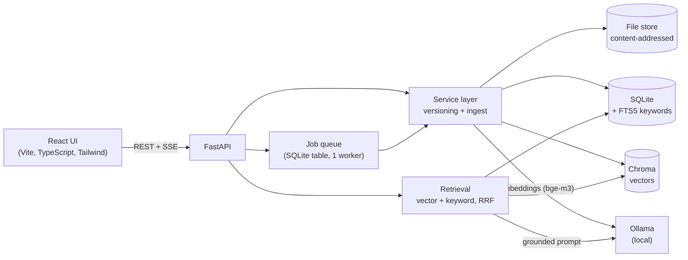

- **Adding a document:** stored once under its SHA-256, parsed (PyMuPDF, python-docx, Tesseract OCR for scanned pages), cut into overlapping pieces of about 600 tokens, embedded with `bge-m3`, and indexed twice: Chroma for meaning, SQLite FTS5 for exact words.
- **Asking:** the glossary writes the documents' words into the question ("vacation" → "vacation (PTO, paid time off)"); both indexes are searched and fused with reciprocal rank fusion; the top 5 passages go into a prompt that allows answers only from them.
- **Answering:** the answer streams over server-sent events; each `[n]` is then checked against the passages and repaired, and the passages and scores are stored with it.
- **Everything else** runs in one process: a job queue on SQLite (no Redis), JSON logs with a request id, Prometheus `/metrics`, and `/health` for Ollama, SQLite, the vector store and the worker.

Why things are the way they are: [docs/decisions/](docs/decisions/) (33 short records).

## Evaluation

A golden set of 53 questions about the demo company ([`backend/demo/eval/`](backend/demo/eval/hilda-luna-golden.json)), each with the file a good answer comes from and the facts it must contain: every shelf, English and Spanish, the same question in other words, and 10 questions whose answer isn't on the shelf searched. Runs use the chat's own retrieval and prompt, and the **Evaluation** page compares any two runs question by question ([decision 0019](docs/decisions/0019-evaluation.md)).

**Answers** (`qwen2.5:3b` on a 7.2 GB laptop CPU, temperature 0, hybrid retrieval, top 5):

| Step | Passed | Required facts | "Not found" when right | Citations to the right file |
|---|---|---|---|---|
| Baseline | 70% | 84% | 100% | 79% |
| + citation repair ([0020](docs/decisions/0020-citation-repair.md)) | 85% | 86% | 100% | 95% |
| + glossary ([0021](docs/decisions/0021-glossary.md)) | 89% | 89% | 100% | 98% |
| + "answer the part it answers" rule ([0022](docs/decisions/0022-prompt-partial-answers.md)) | **91%** | 91% | 100% | 98% |

A final run of the released configuration repeated the last row exactly, with the same 5 questions failing: the 3B model reading or omitting details. The fixes were measured on the questions they were written for, so treat the later steps as best cases. The local model also judged faithfulness (0.74 before and after the fixes), but a 3B judge marked correct answers as unsupported, so that score is kept as a hint, not a result.

**Retrieval** (same 53 questions: right file in the top 5 / ranked first / MRR):

| Retrieval | Hit@5 | Hit@1 | MRR | Time per question |
|---|---|---|---|---|
| Vectors only (`bge-m3`) | 96% | 78% | 0.865 | 2.7 s |
| Keywords only (SQLite FTS5) | 100% | 96% | 0.978 | 2 ms |
| Hybrid, RRF (the default) | 100% | 89% | 0.934 | 2.5 s |
| Hybrid + `bge-reranker-v2-m3` | 100% | 91% | 0.956 | 15 s |

The reranker is off by default: on a laptop CPU it costs about 12 s per question for +0.02 MRR ([decision 0023](docs/decisions/0023-reranker.md)). The [end-to-end report](docs/test-reports/2026-11-09-e2e.md) covers real Ollama on every file type: 53/53 must-pass checks, 7/7 refusals, 6/6 portal questions. To run the evaluation yourself, load the demo company and its golden set (one button each), then start a run on the Evaluation page, or `python -m app.cli eval --answers`.

## Screenshots

| | |
|---|---|
| 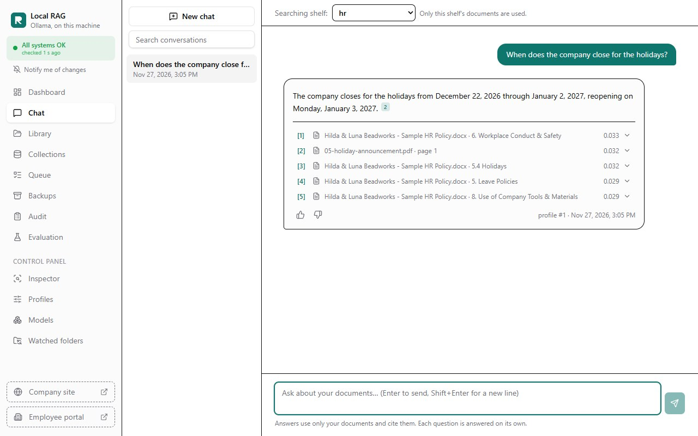 **Grounded answers.** Numbered citations, with the sources and their scores under the answer. | 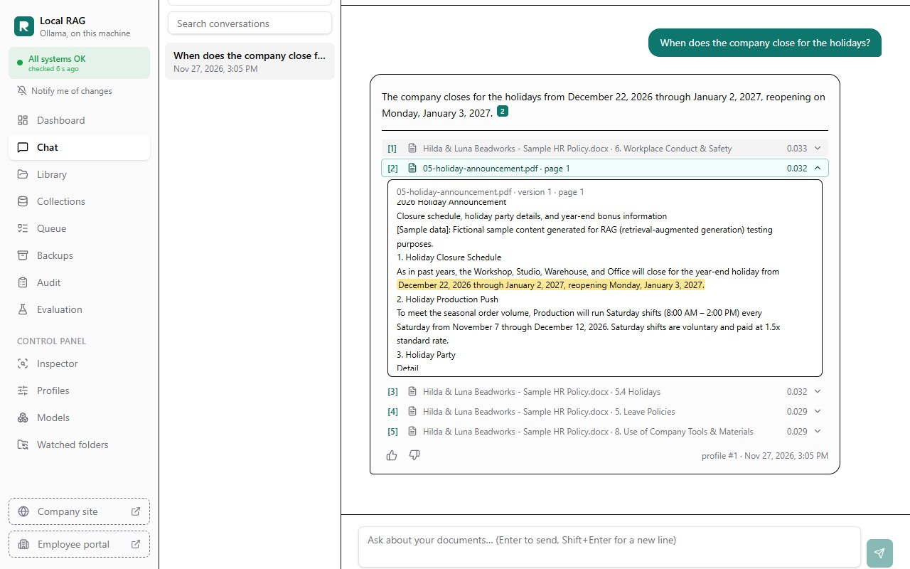 **Check any citation.** The exact passage, with the cited line. |
| 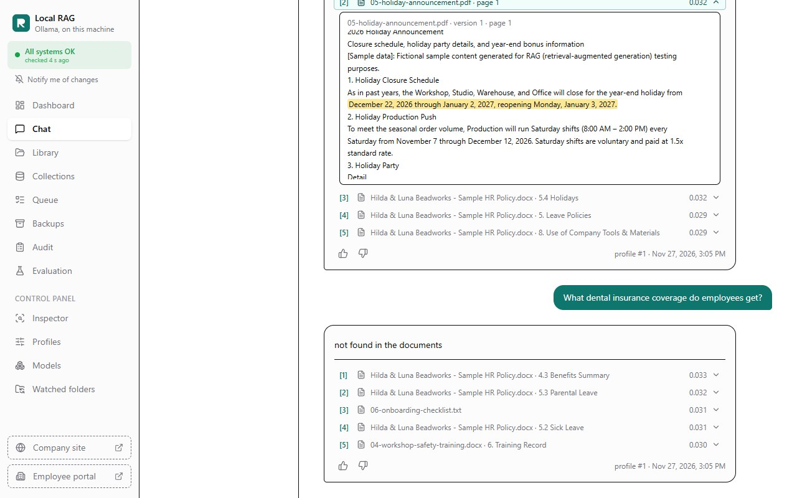 **No guessing.** A question the shelf can't answer gets "not found in the documents". | 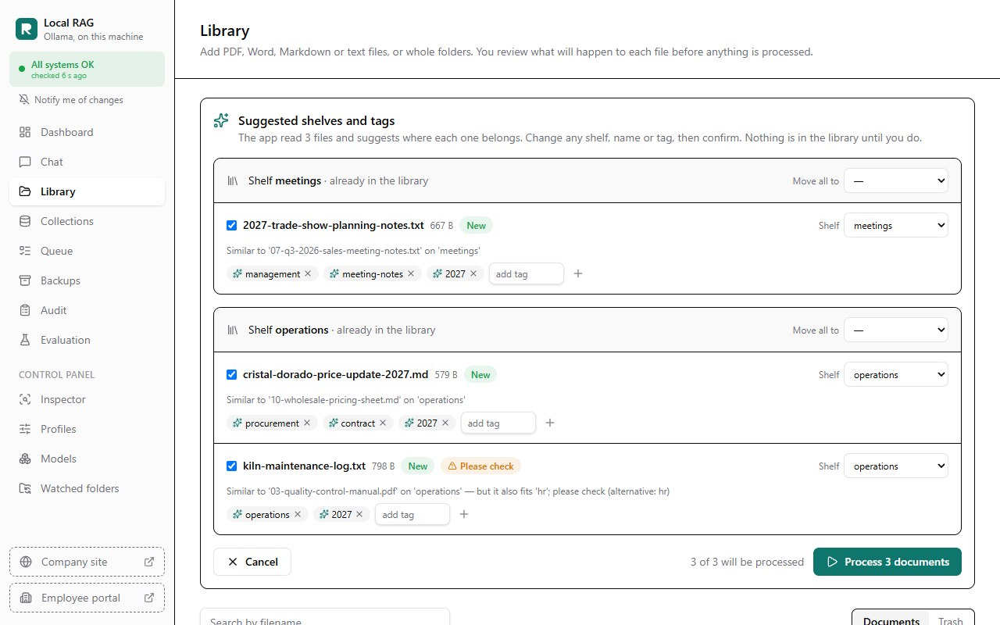 **Suggested shelves and tags.** Review, move and retag, then confirm; one file is marked "please check". |
| 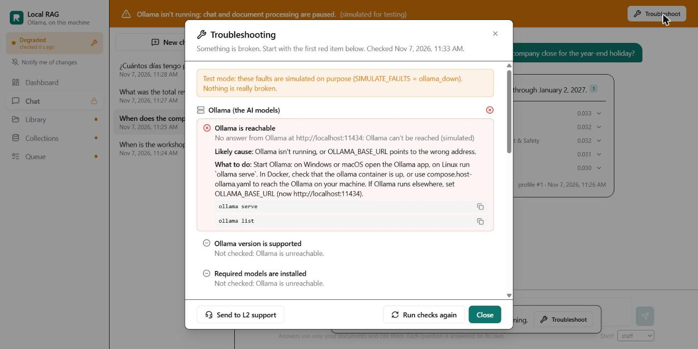 **When something breaks,** the app names the cause and the fix, and pauses what can't work. | 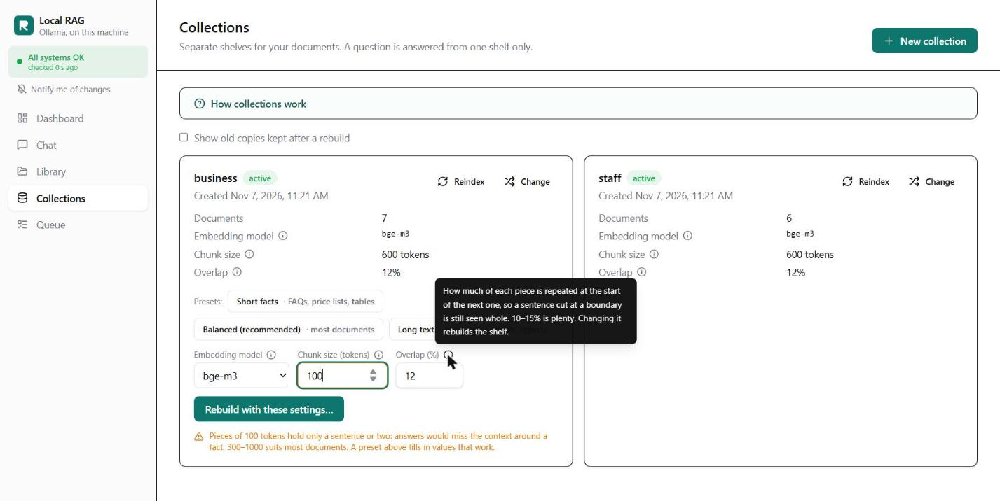 **Settings without jargon.** Tooltips, presets, and warnings for unusual values. |

The demo company also has a public website and an intranet, where employees ask **Luna**: answers only from the shelves shared with the portal, with the cited passage one click away, in English or Spanish ([more about the portal](docs/portal.md), [10-minute walkthrough](docs/walkthrough.md), [slide deck](https://carlosgild-web.github.io/local-rag-ollama/showcase/)).

| | |
|---|---|
| 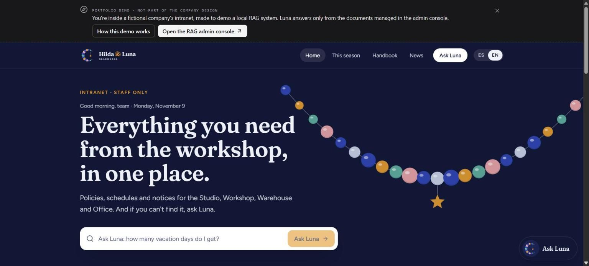 **The intranet.** Season dates, handbook highlights and news, written from the demo documents. | 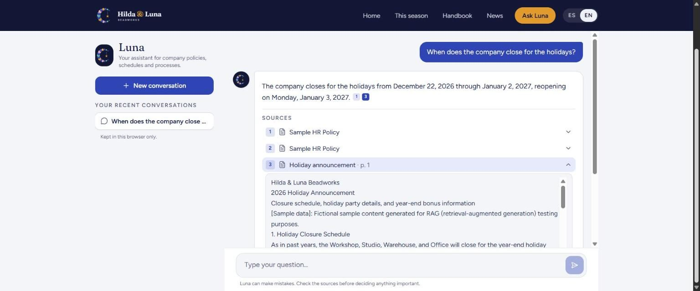 **Luna.** The same rules as the console: cited, or "I couldn't find this". |

## Try it

**You need** 8 GB of RAM (16 GB is comfortable), about 4 GB of disk for the small models, and [Docker Desktop](https://www.docker.com/products/docker-desktop/) or [Ollama](https://ollama.com) with Python 3.11+. No GPU, and no internet once the models are downloaded. [Getting started, step by step →](GETTING_STARTED.md) ([as a web page](https://carlosgild-web.github.io/local-rag-ollama/getting-started.html))

**The start script** (`.\start.cmd` or `./start.sh`) picks a way to run it from what your computer has: the app in Docker using your Ollama, both in Docker, or Python with no Docker (the built web app is downloaded from the GitHub Release and checked against its SHA-256, so Node isn't needed). It suggests `qwen2.5:3b` under 12 GB of RAM, `llama3.1` above, and asks before installing or downloading anything. `stop`, `status`, `backup`, `restore <name>` and `--check` do what they say; `video` starts the fresh demo data the README's video and GIFs use ([decision 0042](docs/decisions/0042-video-mode-and-gif-harness.md)).

**Only Docker?** `docker compose -f compose.yaml -f compose.demo.yaml up -d` pulls `bge-m3` and `qwen2.5:3b` by itself; it needs about 16 GB of RAM, since Docker keeps the models in a VM ([decision 0031](docs/decisions/0031-docker-demo-mode.md)). Then open http://localhost:8000 and click **Load the demo company**.

> **Run it locally or on a private network.** There's no sign-in by default, and the app listens on `127.0.0.1` only. Set a password (`python -m app.cli set-password`) before anyone else can reach it ([decision 0026](docs/decisions/0026-optional-password.md)).

### What each feature needs

| Feature | Needs |
|---|---|
| Answers in the chat and the portal | An Ollama chat model: `qwen2.5:3b` (8 GB of RAM) or `llama3.1` |
| Search, adding files, suggested shelves and tags | `bge-m3` on Ollama |
| Scanned PDFs | Tesseract OCR (in the Docker image; installed separately for Python) |
| The reranker (optional, off by default) | `pip install -r backend/requirements-rerank.txt`, then `python -m app.cli reranker-download` |
| Remaking the README GIFs and video | Windows with Edge, ffmpeg, Node, and Ollama with both models ([`video/README.md`](video/README.md)) |

## Development

```bash
cd backend && python -m venv .venv && .venv/Scripts/pip install -r requirements.txt -r requirements-dev.txt
.venv/Scripts/python -m uvicorn app.main:app --reload --port 8000     # migrations run on start
cd frontend && npm ci && npm run dev                                   # http://localhost:5173, /api goes to :8000
```

Settings are environment variables ([`backend/.env.example`](backend/.env.example)). The LLM, embedding and vector-store clients are interfaces with fake implementations, so the tests and CI never need Ollama.

| Check | Command | Result |
|---|---|---|
| Backend tests (fakes) | `pytest -q --cov` | 403 passed, 92 % coverage |
| Lint and format | `ruff check . && ruff format --check .` | clean |
| Frontend | `npm run build` (type check + build) | builds |
| Video tooling | `cd video && npm run video:check && npm run video:test` | every callout resolves; 9 tests pass |
| CI on every push | lint, tests, frontend build, `docker build`, the start scripts on Windows, macOS and Linux; CodeQL, secret scanning, Dependabot | green |
| End to end (real Ollama, not in CI) | [`e2e/run_e2e.py`](e2e/README.md) | [report](docs/test-reports/2026-11-09-e2e.md) |

| Folder | What's there |
|---|---|
| `backend/app/` | FastAPI app: `api/`, `core/`, `ingest/`, `retrieval/`, `llm/`, `versioning/`, `jobs/`, `db/`, `eval/` |
| `backend/tests/` · `backend/migrations/` | pytest suite (fakes only) · Alembic |
| `backend/demo/` | The fictional Hilda & Luna documents, golden set and glossary |
| `frontend/src/` | React + Vite + TypeScript + Tailwind: the console, `portal/` (Luna) and `site/` (the public website) |
| `scripts/`, `start.cmd`, `start.sh` | The one-command start, and the site's image tools |
| `e2e/` · `e2e/showcase/` | The end-to-end kit · the README GIFs (`npm run showcase`) |
| `video/` | The README video: two passes, the stage and its checks |
| `docs/` | Decisions, test reports, the walkthrough, the project page and slide deck |

Your documents, the database, vectors and backups live in `data/` (or a Docker volume, or `backend/data/` when the backend runs by hand); none of it is ever committed.

## How it was built

I built this project with [Claude Code](https://claude.com/claude-code) as an AI coding assistant, phase by phase from [PLAN.md](PLAN.md).

**My part:** the requirements and the product decisions ("suggest a shelf, but let me decide", "few broad shelves", "never lose data"), the plan for each phase, the evaluations on real models, and the review of every change.

**Claude Code's part:** most of the code, under that direction, and the technical options it proposed and measured.

Every deviation from the plan is a decision record in [`docs/decisions/`](docs/decisions/).

## About

Portfolio project #1 of the Hilda & Luna series, AI tools for a fictional bead-making company:

1. **local-rag-ollama**: fully local RAG with cited answers over versioned documents
2. [luna-hybrid-agent](https://github.com/carlosgild-web/luna-hybrid-agent): an agent that picks between document search, read-only SQL and an FX API
3. [hl-create-design](https://github.com/carlosgild-web/hl-create-design): KiCad projects with the company title block; the AI guides, the code decides
4. [hl-bead-studio](https://github.com/carlosgild-web/hl-bead-studio): glass beads and charms from a sentence to CAD, drawing and render

Also: [windows-system-monitor](https://github.com/carlosgild-web/windows-system-monitor), config-driven monitoring and auto-remediation for Windows.

Hilda & Luna Beadworks, its people and its documents are fictional; the website's photos were made with Google Gemini ([details](docs/site-images.md)). Roadmap: [PLAN.md](PLAN.md) · changes: [CHANGELOG.md](CHANGELOG.md).

## License

[MIT](LICENSE). The bundled Fraunces and Figtree fonts keep their own [SIL Open Font License 1.1](https://openfontlicense.org).
