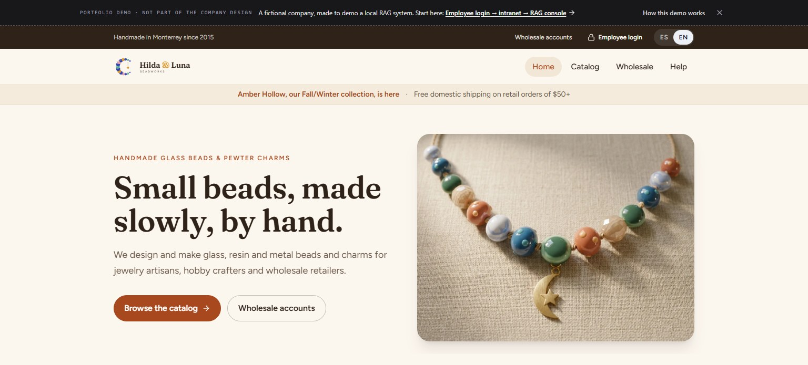
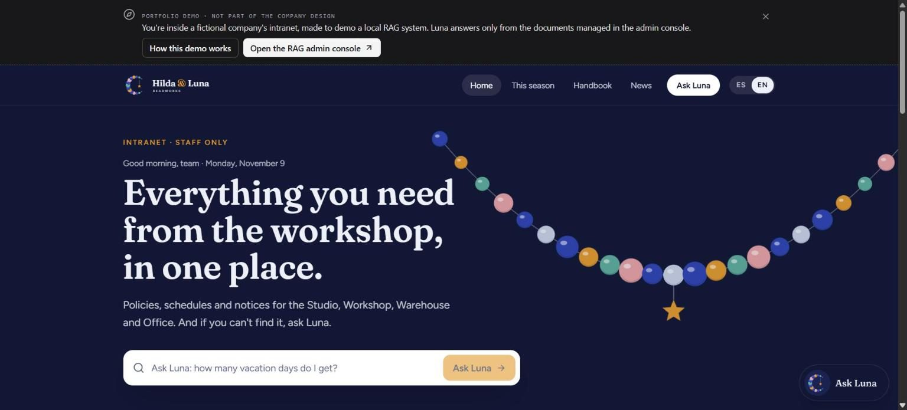
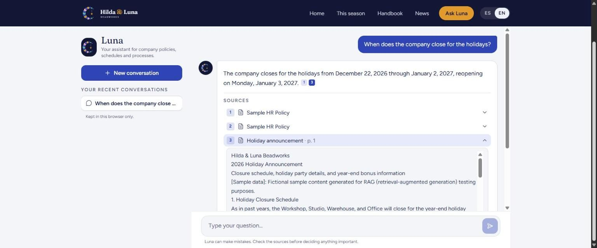
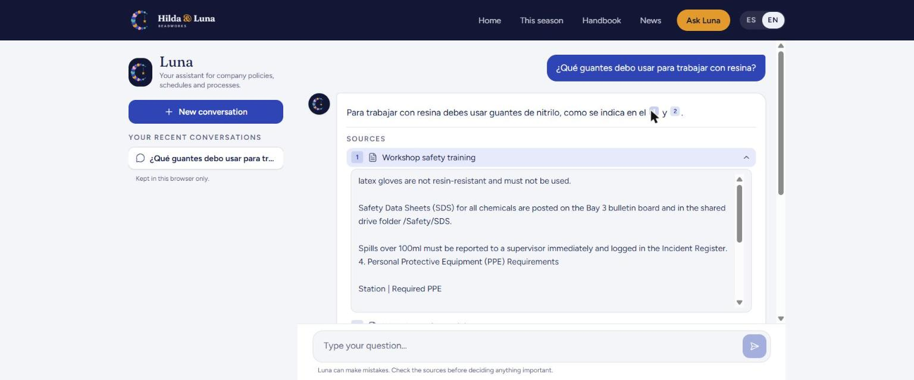

# The employee portal

The console above is for the person who manages the documents. The portal shows the other side: the people who need answers from them.

| | |
|---|---|
|  **The company's website.** Written from its customer documents, with product photos made with Google Gemini. |  **The intranet.** Season dates, handbook highlights and news. The banner on top is the reviewer's demo guide. |
|  **Luna.** Answers only from the documents, with the cited passage one click away. |  **In Spanish too.** A Spanish answer from an English manual. |

- **A company intranet** for *Hilda & Luna Beadworks*, a fictional bead and charm maker in Monterrey. It has a season timeline, handbook highlights, department hours and news, all written from the demo documents.
- **Luna**, in a floating chat bubble on every page or full screen at `/intranet/luna`. Luna searches **every shelf marked "Visible in the employee portal"** (a switch on each shelf in Collections). Each shelf is searched with its own embedding model, and the results are merged by rank ([decision 0010](decisions/0010-employee-portal.md)).
- **Same rules as the console:** answers only from the documents, numbered citations with the exact passage, and a clear "I couldn't find this" when the documents don't say.
- **ES / EN switch.** The interface changes language and Luna is asked to answer in it, whatever language the documents are in.
- **Kept apart, still visible.** Employee chats don't appear in the console's chat history; the dashboard lists them under *Employee questions*, with their 👍/👎 feedback stored like any other answer.
- **Simulated internal access:** there is no real sign-in. The footer says so.
- **A public website** at `/site`, the company's outside face. It's modeled on real bead and charm makers: a home page with collections and the workshop's story, a catalog, a wholesale page, and help on shipping, returns and FAQ. All of it is written from the customer-facing demo documents. Its photos were made with Google Gemini: each product photo starts from a Blender render of the catalog item, so colors and shapes match ([how the images are made](site-images.md), [decision 0012](decisions/0012-site-images-with-gemini.md)). Its forms are demos that send nothing. **Employee login** opens a simulated staff sign-in, with one button into the intranet ([decision 0011](decisions/0011-public-site.md)).

### Try the demo

Start the app ([Try it](../README.md#try-it)). While the library is empty, the dashboard offers the demo company's 11 fictional documents: **See the documents** to read the originals first, then **Load the demo company**. Developers can use `python -m app.cli seed-demo` instead.

Then follow the path a visitor would:

1. **http://localhost:8000/site**: the company's public website.
2. **Employee login → Enter as demo employee**: the intranet. Ask Luna something, for example "When does the company close for the holidays?", and open a source.
3. **Demo guide → Open the RAG admin console**: the console behind it all, with shelves, automatic versions, the trash, the job queue and the troubleshooter.

The **demo guide** at the top of the site and the intranet is marked as outside the company design. It's there for reviewers, and its *How this demo works* panel lists things to try. The dashboard's **Company site** and **Employee portal** buttons lead back the other way. The [walkthrough](walkthrough.md) covers the same path, step by step.
