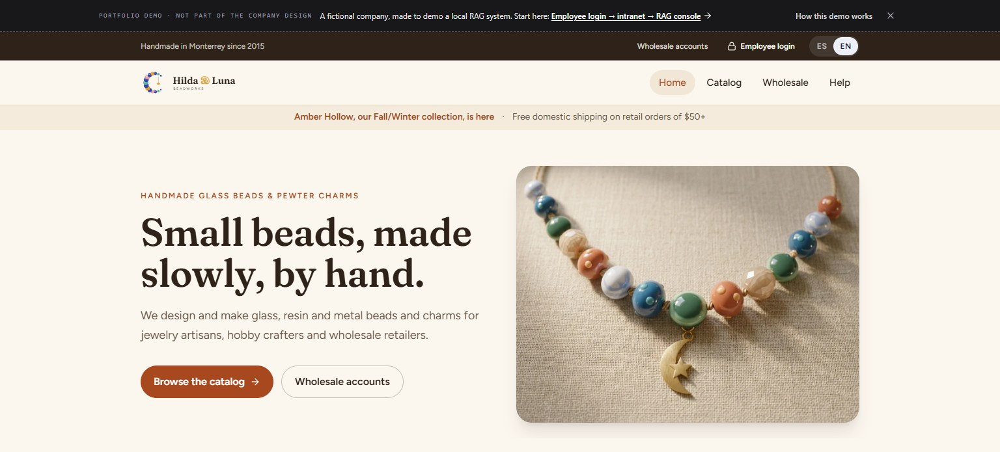
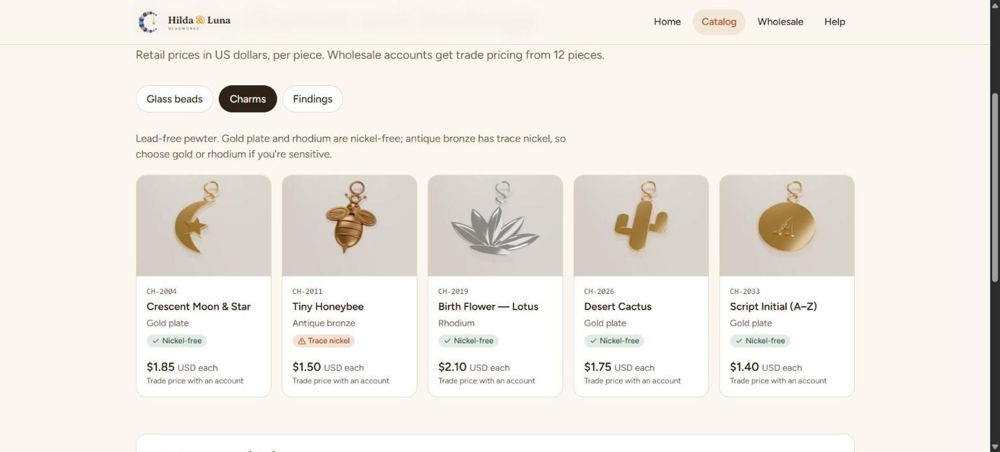
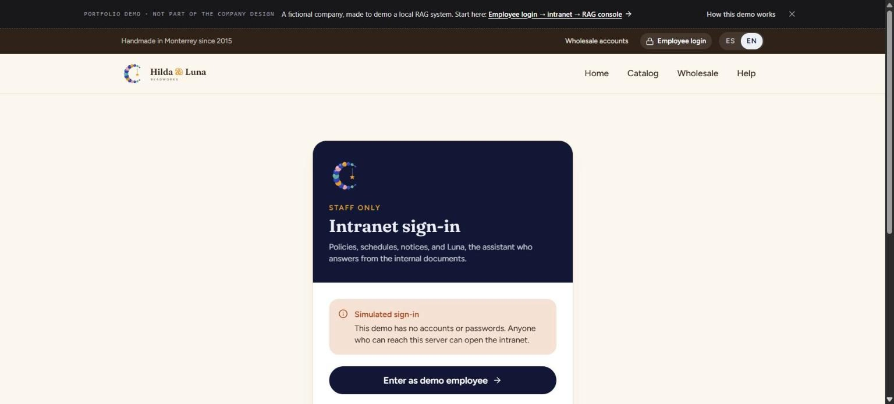
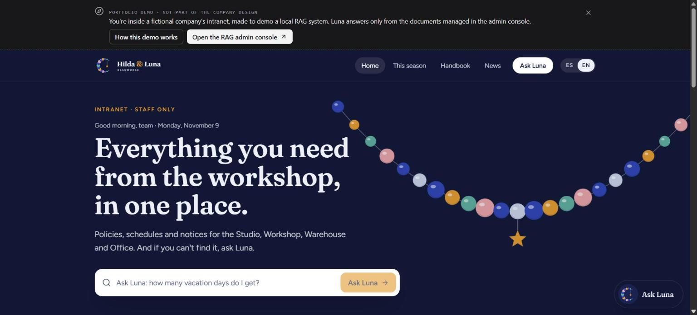
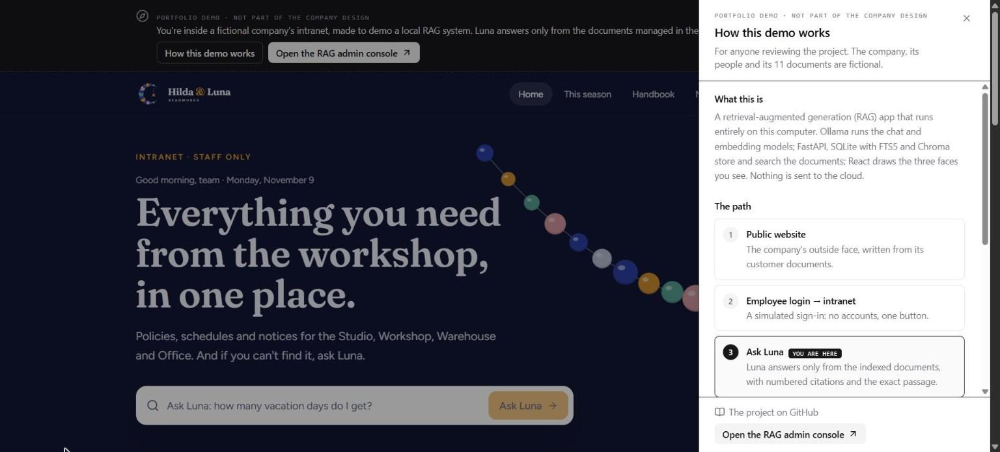
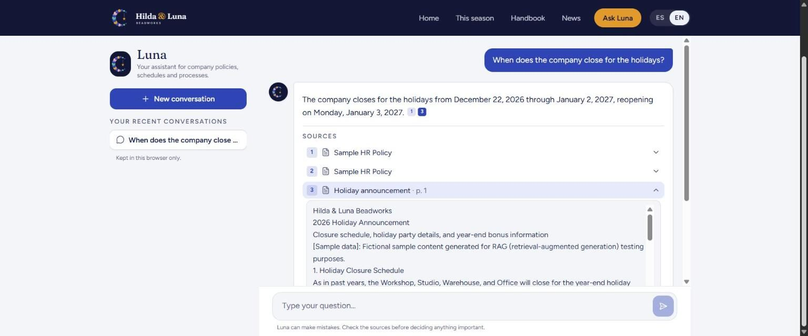
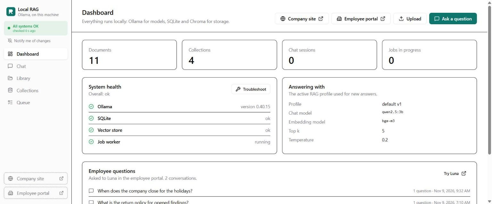
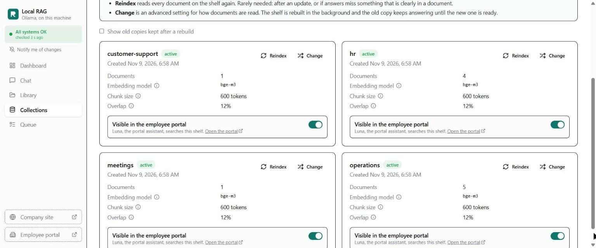

# A reviewer's walkthrough

This is a 10-minute tour of what the project does, in the order a visitor meets it: a fictional company's website, its intranet with Luna, and the RAG admin console behind both. Everything runs on one computer. Ollama runs the models, and nothing is sent to the cloud.

*Hilda & Luna Beadworks, its people and its 11 documents are fictional.*

## Before you start

1. Start the app ([Quick start](../README.md#quick-start)). You need Ollama with `bge-m3` and a chat model (`llama3.1`, or `qwen2.5:3b` on a machine with about 8 GB of RAM).
2. Load the demo documents: on the dashboard's *New here?* card, click **See the documents** to read the originals, then **Load the demo company**. This creates four shelves (customer-support, hr, meetings, operations) from `backend/demo/hilda-luna/`. Developers can run `python -m app.cli seed-demo` instead.
3. Open **http://localhost:8000/site**.

Answers take a while on a laptop CPU: the median was 44–59 seconds in the end-to-end tests ([latest report](test-reports/2026-11-09-e2e.md)).

## 1. The company's website

This is the company's public face, modeled on real bead and charm makers. Everything on it is written from the **customer-facing** documents: the catalog, the shipping and returns policy, the FAQ and the wholesale price sheet. Internal facts stay on the intranet.

The dark strip at the top is **not part of the company's design**. It's the demo guide, there for reviewers, and it points the way: *Employee login → intranet → RAG console*.

The product photos were made with Google Gemini. Each one starts from a 3D render of the item made in Blender by [`scripts/render_site_art.py`](../scripts/render_site_art.py), so the photo keeps the catalog's colors and shapes. See [how the images are made](site-images.md) and the [full set of product photos](showcase/img/30-product-photos.jpg).

## 2. Into the intranet

**Employee login** opens a simulated sign-in. It says plainly that there are no accounts, and it has one button. Nothing in this demo has a login, so run it locally or on a private network.

The intranet has season dates, handbook highlights, hours and news. Every card can ask Luna about itself. The banner on top is the demo guide again: **How this demo works** opens a panel, and **Open the RAG admin console** opens the console in a new tab.

## 3. Ask Luna

Luna answers **only from the indexed documents**:
- Each answer has numbered citations, and each source opens the exact passage it came from.
- A question the documents don't cover gets a clear "I couldn't find this" instead of a guess.
- Switch to **ES** and Luna answers in Spanish, even from English documents.

Try:
- "When does the company close for the holidays?"
- "How many PTO days do I get in my third year?"
- "Which gloves should I use for resin work?"
- Something the documents don't say, like "What's the Wi-Fi password?"

## 4. The RAG admin console

This is the product itself, for the person who manages the documents. The dashboard shows system health, the active retrieval profile, and **Employee questions**: what people asked Luna, with their feedback.

Each **shelf** (collection) has its own embedding model and chunking settings. Luna searches every shelf with **Visible in the employee portal** turned on. Turn one off and Luna stops using it, and the change is written to the audit log.

More to try in the console:
- **Library:** drop in a file or a folder. The app suggests a shelf and tags for each file, and you confirm. Upload a changed copy of a document under the same name and it becomes **version 2**. The old version's chunks stay indexed but inactive.
- **Chat:** the admin chat asks one shelf at a time, with the same citations.
- **Trash:** deleting is soft, with 30 days to restore.
- **Troubleshooter:** stop Ollama and the app names the cause and the fix, and pauses what can't work.
- **API:** version rollback flips the active version without re-embedding. It's in the API (`POST /api/documents/{id}/rollback`, see http://localhost:8000/docs); a versions screen is on the roadmap.

## How it fits together

- **Hybrid retrieval:** vector search in Chroma plus keyword search in SQLite FTS5, fused with reciprocal rank fusion. Shelves that share an embedding model are ranked together; vectors from different models are never compared.
- **Reproducible answers:** every answer stores its retrieval profile, passages and scores.
- **One service layer** for every write to SQLite, Chroma and the file store, and an audit log for uploads, deletes, rollbacks, rebuilds and settings changes.

The [README](../README.md) has the architecture and the engineering highlights, and [`docs/decisions/`](decisions/) has the reasoning behind each choice.
